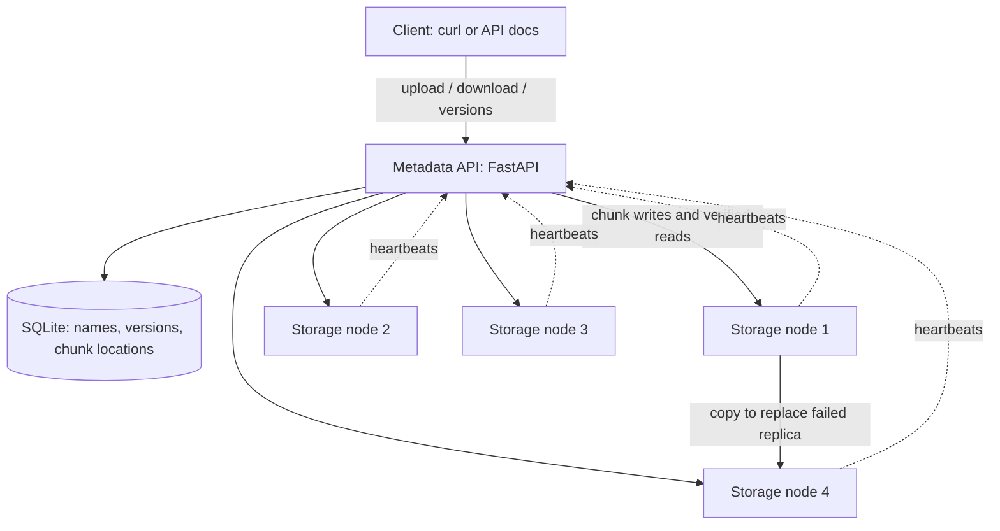

# ReplicaFS

[](https://github.com/pugazhjs9/replicafs/actions/workflows/ci.yml)

**A fault-tolerant distributed file storage backend, built to make the moving parts understandable.** Upload a file once; ReplicaFS splits it into chunks, places copies on different storage nodes, checks data integrity, and repairs missing copies when a node fails.

This is a runnable educational implementation of the submitted problem statement: **“ReplicaFS: A Fault-Tolerant Distributed File Storage System on Free-Tier Cloud Nodes.”** The repository provides a local cluster and a private-network cloud deployment guide. Cloud accounts and resources are not provisioned automatically.



Three copies per chunk is the default target. Four storage nodes in the demo provide somewhere to put a replacement while one node is still down. Containers on one laptop demonstrate process failure; separate machines are needed to tolerate the laptop itself failing.

## Start here

**New to the subject?** Read [the beginner learning path](docs/00-START-HERE.md). It explains the words, the code, the commands, and what to say in a project presentation.

You need Git, Docker with Compose, and `curl` for this route:

```bash
git clone https://github.com/pugazhjs9/replicafs.git
cd replicafs
cp .env.example .env
docker compose up -d --build
curl --fail http://127.0.0.1:8000/health
curl --fail http://127.0.0.1:8000/nodes
```

Wait until `/nodes` shows four `ALIVE` entries. API documentation: **http://127.0.0.1:8000/docs**.

```bash
printf 'My first distributed file\n' > hello.txt
curl --fail -F file=@hello.txt http://127.0.0.1:8000/files
curl --fail -o recovered.txt http://127.0.0.1:8000/files/hello.txt
cmp hello.txt recovered.txt
curl --fail http://127.0.0.1:8000/cluster
```

`cmp` produces no output when the files match. Stop with `docker compose down`; named volumes keep your files. `docker compose down -v` also deletes those volumes and their contents.

The local example leaves tokens blank and binds published ports to your own computer. Before using a remote network, set independent `API_TOKEN` and `CLUSTER_TOKEN` values and follow [deployment and recovery](docs/08-deployment.md). When `API_TOKEN` is set, add `-H "Authorization: Bearer $API_TOKEN"` to file and administration requests.

## Run without Docker

Python 3.13 is the reference version.

```bash
python3.13 -m venv .venv
source .venv/bin/activate
python -m pip install -r requirements.txt
python scripts/dev_cluster.py
```

Keep that terminal open. Run the same `curl` commands in a second terminal. Ctrl+C stops the child servers; `data/dev` keeps their database, chunks, and logs. Use `--base-port 9000 --data-dir data/dev9000` for a separate dataset if ports 8000–8004 are occupied. [The hands-on guide](docs/05-try-it-yourself.md) explains each step.

## Demonstrate failure recovery

With the Docker cluster running:

```bash
./scripts/demo_failover.sh
```

The script uploads a multi-chunk file, stops node2, verifies the downloaded bytes, waits for full replication while node2 remains down, then starts node2 again. It restores the stopped node even if the script fails or is interrupted. With token protection enabled, export the matching `API_TOKEN` before running it.

## What is implemented

| Capability | Behavior |
|---|---|
| Chunking | Configurable fixed-size chunks with an ordered metadata manifest. |
| Replication | Copies on separate node identities, least-loaded placement, and retry of alternate nodes. |
| Failure detection | Periodic heartbeats; expired nodes stop counting as live; returning disks are verified before trust. |
| Repair | A background monitor recreates missing copies from surviving verified data. |
| Integrity | SHA-256 per chunk and whole file; corrupt or missing copies are excluded and repaired. |
| Safe downloads | Data is verified before a successful response is sent; unavailable data returns an HTTP error. |
| Version history | Repeated uploads under one name create numbered versions; earlier versions remain downloadable. |
| Undo delete | Soft delete hides every visible version; restore makes deleted versions visible again. |
| Storage safety | Bounded chunk requests, checksum checks, unique temporary files, atomic replacement, and controlled disk errors. |
| Access control | Optional separate bearer tokens for client operations and internal node traffic. |
| Operations | Health endpoints, replication metrics, graceful shutdown, persistent volumes, and a repeatable failure demo. |

## Verify it

```bash
python -m pip install -r requirements-dev.txt
python -m pytest -v
```

Tests include isolated unit/API cases and a real five-process cluster. The integration tests use temporary directories and random local ports. See [test strategy and case coverage](docs/07-testing.md) for commands, the scenario matrix, and what the tests cannot prove. Passing a finite test suite does not establish that every possible failure has been tested.

The [verification record](docs/10-verification.md) captures **298 passing tests**,
**95.7% combined coverage**, the Docker failover proof and the native-launcher
restart exercise, with the tested revision and environment.

## Repository map

```text
replicafs/
  common.py                  chunk iteration, hashes, placement helpers
  limits.py                  raw upload-body bounds before multipart parsing
  security.py                client and cluster bearer-token checks
  metadata/
    db.py                    nodes, files, chunks, replicas
    app.py                   file and cluster API; monitor lifecycle
    replicator.py            failure detection, integrity checking, repair
  storage/app.py             chunk persistence and heartbeat sender
scripts/
  dev_cluster.py             native local cluster launcher
  demo_failover.sh           Docker failure-recovery proof
tests/                       unit, API, recovery, real-process integration tests
deploy/systemd/              Linux service units and private-network settings
docs/                        beginner lessons, reference, deployment, presentation
```

## Learning and project evidence

- [Big idea and glossary](docs/01-the-big-idea.md)
- [Upload, download, failure, and recovery explained](docs/02-how-it-works.md)
- [Code walkthrough](docs/03-code-walkthrough.md)
- [Interview questions](docs/04-interview-questions.md)
- [Hands-on exercises](docs/05-try-it-yourself.md)
- [API and configuration reference](docs/06-api-reference.md)
- [Testing guide](docs/07-testing.md)
- [Cloud deployment and backup](docs/08-deployment.md)
- [Milestones, assessment demo, and resume wording](docs/09-milestones-and-resume.md)

## Design boundaries

One metadata server and SQLite are the coordinator and the single point of failure. Run one metadata worker. There is no consensus protocol, automatic metadata failover, per-user isolation, quota accounting, encryption at rest, or permanent-delete garbage collector. Deleted versions keep consuming disk. A cluster cannot recreate a chunk after every usable copy is lost.

The design favors readable correctness and demonstrable recovery over throughput: transfers and repair are mostly sequential; downloads need temporary space on the metadata host; metadata operations and periodic scans suit small clusters. See the deployment guide before storing anything valuable.
