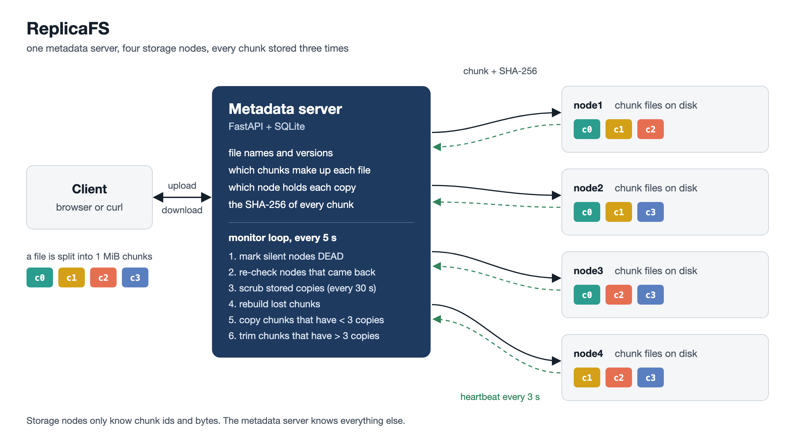
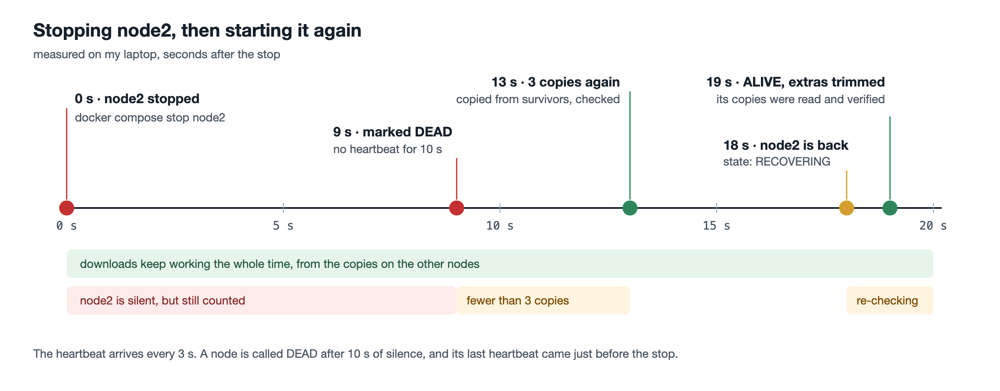
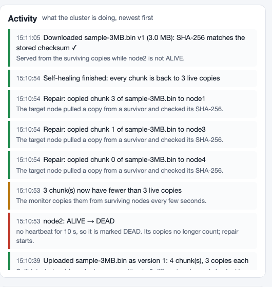
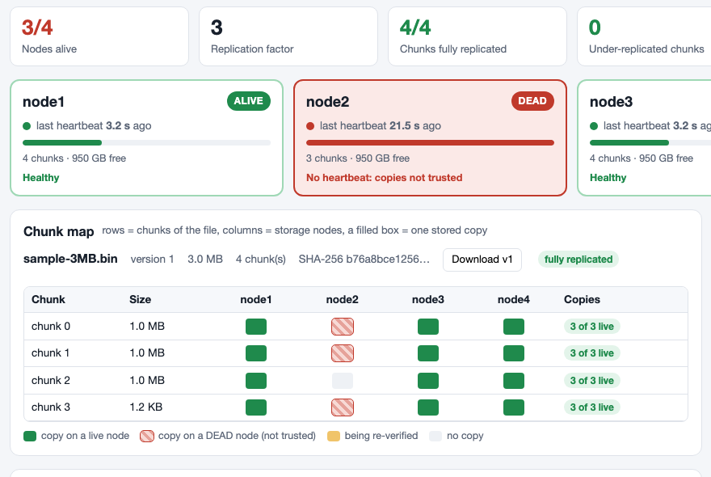
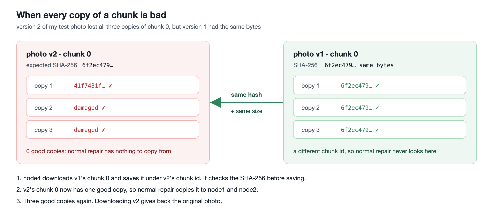

# I Built a Small Google File System in Python, Then Tried to Break It

*What happens to a file when the server holding it dies? I built ReplicaFS for a university course to find out.*



*ReplicaFS: one metadata server and four storage nodes. Every chunk of a file lives on three of them.*

Halfway through testing my project, I ran `docker compose stop node2` and took down one of the four servers holding my files.

For nine seconds nothing visible happened. Then node2's card on my dashboard turned red. Four seconds after that, every chunk that had a copy on node2 had a new copy on another server, and when I downloaded the file, its SHA-256 hash still matched the original. I hadn't touched anything.

This is ReplicaFS, a small distributed file store. It cuts files into chunks, keeps three copies of every chunk on different machines, and repairs itself when a machine dies or a disk silently corrupts data. It's about 1,700 lines of Python and runs on a laptop with Docker Compose. [The code is on GitHub.](https://github.com/pugazhjs9/replicafs)

I'm a B.Tech Computer Science and AI student at Newton School of Technology, Rishihood University, and ReplicaFS was my backend project for our Professional Development & Career Readiness (PDC) course.

I'd actually met replication before, without really understanding it. During my internship as an API engineer, my manager asked me to replicate all of our databases and tables on Google Cloud and keep the copies in sync on a schedule, so every run copied over the rows that had changed since the last one. I set it up, and the copies just appeared.

In the same internship I stored files in Amazon S3, and I never once wondered what S3 does when one of its own disks dies. You upload a file and it's just there. Both times, the cloud did the hard part for me.

I was comfortable building APIs, but I'd never built anything that had to keep working while its own machines failed. That's what I wanted to learn, so that's what I built.

## The problem, and what I set out to build

The problem is easy to state. A file that lives on one machine is only as safe as that machine. If the disk dies, the file is gone. If the disk hands back slightly wrong bytes without reporting an error, the file is damaged, and nobody finds out until they open it.

My project brief was a fault-tolerant file store that could run on free-tier cloud machines, the kind of small, cheap servers you can't expect to stay up forever. Before writing any code, I wrote down what it had to do:

- keep every file downloadable when a storage server dies
- notice a dead server by itself, with nobody watching
- make new copies of anything that was lost
- catch corrupted data, both when a file is downloaded and long before anyone asks for it
- prove that every download is exactly the bytes that were uploaded

I built it in Python 3.13. Both kinds of server are FastAPI apps run by Uvicorn, the metadata lives in SQLite (through SQLAlchemy), and the servers talk to each other over HTTP using httpx. Every chunk and every file gets a SHA-256 checksum. Docker Compose runs the whole cluster, five servers, on one laptop, and the dashboard is a single page of plain HTML and JavaScript. The tests use pytest, and GitHub Actions runs them on every push.

Most of the design comes from a paper Google published in 2003. The rest came from bugs.

## Starting from the GFS paper

In 2003, Sanjay Ghemawat, Howard Gobioff and Shun-Tak Leung published [The Google File System](https://research.google/pubs/the-google-file-system/). Early in the introduction there's a line I kept coming back to: "component failures are the norm rather than the exception."

Google was storing its data on thousands of cheap machines, so at any moment some disk or server somewhere was broken. GFS doesn't treat that as an emergency. It expects machines to die, notices when they do, and makes new copies of whatever was lost.

I couldn't build all of GFS, but its core ideas fit in a student project:

- one coordinator (GFS calls it the master) and many storage servers (chunkservers)
- files cut into fixed-size chunks: 64 MB in GFS, 1 MiB in my demo, so a 9 MB photo becomes nine chunks you can actually see
- three copies of every chunk
- heartbeats, so the coordinator knows which servers are still alive
- checksums, plus a background scan that finds corruption before anyone asks for the file

I also cut corners that GFS doesn't. I'll be upfront about those near the end.

## Two kinds of server

The metadata server is the only part that knows what a file is. Its SQLite database holds file names and versions, the chunks that make up each file, the SHA-256 hash of every chunk, and which storage node has each copy. It's a FastAPI app, and it's the one the client talks to.

The storage nodes are deliberately dumb. Each one is another small FastAPI app that saves chunks as plain files named by a random chunk id. A node doesn't know which file a chunk belongs to, or that other copies exist anywhere. It can save bytes, return bytes and delete bytes. Every three seconds it sends the metadata server a heartbeat.

Keeping the nodes dumb made the rest easier to think about. Every decision, like where a chunk should go or whether a copy can be trusted, is made in one place.

## Writing a file

When you upload a file, the metadata server reads it 1 MiB at a time. For each chunk it computes a SHA-256 hash, picks three storage nodes, and sends each of them the chunk along with the hash it expects.

Choosing the nodes is the shortest function in the project (docstring trimmed):

```python
def pick_nodes(nodes, k: int):
    """Choose up to k nodes for a new chunk, least-loaded first."""
    return sorted(nodes, key=lambda n: (n.chunk_count, n.id))[:k]
```

The emptiest nodes go first. GFS has a similar rule: it places new replicas "on chunkservers with below-average disk space utilization."

A storage node checks what it receives. It hashes the bytes itself and refuses to save them if the result doesn't match the `X-Checksum` header:

```python
actual = sha256_hex(data)
if expected is not None and expected != actual:
    raise HTTPException(
        status_code=422, detail="checksum mismatch: chunk corrupted in transit"
    )
```

This is a different kind of replication from the scheduled sync I set up during my internship. There, a copy was only as fresh as the last run. In ReplicaFS, an upload doesn't return until the metadata server has tried to write all three copies. If fewer than three nodes are up, the upload still succeeds with fewer copies, gets marked as degraded, and repair fills in the rest once more nodes are available.

Files never change once they're written. Uploading the same name again creates version 2 and leaves version 1 alone. That one decision let me skip the part of the GFS paper about leases and write ordering, which exists because GFS files can be changed in place. It also saved me later, in a way I didn't plan.

## How do you know a server is dead?

Strictly speaking, you can't. A server that crashed and a server that's just very slow look the same from the outside. You stop hearing from them.

So each storage node sends a heartbeat every 3 seconds, and the metadata server marks a node DEAD after 10 seconds of silence. Ten seconds is a judgment call. Make it shorter and a slow network makes healthy nodes look dead. Make it longer and the cluster runs with missing copies for longer.

Something I got wrong for a while: I assumed the heartbeat checked my data. It doesn't. A heartbeat only says "I'm running, I hold this many chunks, I have this much free disk." A node whose disk is corrupting files sends perfectly cheerful heartbeats. Checking the data is a separate job.

Everything the metadata server does on its own happens in one loop that runs every 5 seconds:

```python
replicator.mark_dead_nodes(db, DEAD_AFTER_SECONDS)
replicator.validate_recovering_nodes(db, client)
if time.monotonic() >= next_scrub:
    result = replicator.verify_replicas(db, client, SCRUB_BATCH_SIZE, cursor)
    ...
replicator.rebuild_lost_chunks(db, client)
replicator.re_replicate(db, client, REPLICATION_FACTOR)
replicator.trim_over_replicated(db, client, REPLICATION_FACTOR, DEAD_AFTER_SECONDS)
```

In my first commit this loop had two lines: mark dead nodes, then copy chunks that were short. Every other line is there because something went wrong.

## Repairing without a human

Once a node is DEAD, its copies stop counting. Any chunk left with fewer than three live copies gets repaired. The metadata server picks a healthy node that doesn't have the chunk yet and tells it to pull a copy from one of the survivors. The receiving node checks the SHA-256 before saving, so a damaged source can't spread its damage.

This is the run from the start of the post, with timings:



*Measured on my laptop: one metadata server and four storage nodes in Docker Compose.*

Downloads kept working the whole time. For every chunk, the download code tries each copy in turn and checks its hash, so a missing node just means it moves on to the next copy. The hash of the whole file is checked once more before the first byte goes back to the client.

The dashboard keeps a feed of what the cluster is doing, which is the easiest way to watch this happen:



*The activity feed from an earlier run: node2 marked DEAD, three chunks short, all three repaired within a second, then a download served from the surviving copies.*

## The node that comes back

Repairing is the easy half. The harder question is what to do when the dead node returns.

Say node2 restarts and sends a heartbeat. The database still says node2 holds copies of chunks 0, 1 and 3. Should the metadata server believe it?



*node2 is DEAD. Its striped copies are still in the database, but they no longer count toward the three.*

Not yet. The disk might have been replaced while the server was off. A chunk might have been half-written when it went down. If the metadata server trusted those old records, it would send downloads to copies that aren't there. Worse, it would count them toward the three copies and stop repairing.

So a returning node goes into a third state, RECOVERING. Its old copies don't count yet. The metadata server reads every chunk the node claims to have and checks each one against the stored SHA-256. Missing or bad copies are dropped. Only after that does the node become ALIVE again.

One of my end-to-end tests does the worst version of this on purpose. It kills a node, deletes its entire data folder and starts it again, so the node comes back with an empty disk while the database is full of claims about it. The test passes only if every false claim is removed and the file still downloads byte for byte.

There was one more trap. What if a node restarts again while it's being checked? The check could finish and mark the node ALIVE based on a disk that changed underneath it. I fixed this with a counter called `recovery_generation` that goes up every time a node restarts. A check can only promote the node if the counter hasn't moved since the check started. GFS deals with a related problem using chunk version numbers. My version is cruder, but the instinct is the same: a server that's been away has to prove its data is good.

## Corruption nobody asks about

Disks sometimes hand back the wrong bytes without reporting an error. If nobody reads a file for months, nobody notices. Then one day you need it, and all three copies have gone bad.

GFS chunkservers "scan and verify the contents of inactive chunks" during idle periods. ReplicaFS has a scrubber that does the same job from the metadata server. Every 30 seconds it reads the next 100 stored copies, hashes each one, and drops any copy whose hash is wrong. The normal repair step then replaces it from a good copy.

To demo this, I damage a copy by hand: I use `docker compose exec` to write junk into a chunk file inside a node's container. The scrubber reaches that copy within about a minute, or right away if I click **Check all copies now** on the dashboard, and repair puts a good copy back.

The first time I tried this in front of the dashboard, it showed nothing at all. The scrubber found the bad copy and the repair finished between two refreshes of the page, so as far as the screen was concerned, nothing had happened. That's why the dashboard has an activity feed now. Without it, the system fixed things too fast for me to prove it had fixed anything.

Running that demo over and over is also how I found my two worst bugs.

## Two bugs my own demos found

### A chunk with four copies

After a few rounds of stopping and restarting node2, I noticed that some chunks on the dashboard had four copies.

It made sense once I traced it. node2 dies, so its chunks are repaired onto other nodes and are back to three copies. Then node2 comes back, passes its checks, and its old copies count again. Three plus one is four, and nothing ever removed the extra.

An extra copy sounds harmless, but it wastes disk, and the number grows every time a node goes down and comes back. The fix is a trimming step at the end of the monitor loop. The tricky part is deciding which copy to delete. The obvious rule is to delete the copy on the fullest node, which is close to what GFS does when it rebalances. But if one of the copies I kept had gone bad without anyone noticing, I'd be left with two good copies while the dashboard showed three.

So trimming reads before it deletes. It goes through the live copies, least-loaded node first, and checks each one's SHA-256 until three have passed. Those three are kept, and every other copy is extra. If it can't prove three good copies, it deletes nothing. It also removes the database record before the file, so a crash in between leaves an unused file on disk instead of a record pointing at nothing.

The first time it ran on my demo cluster, it removed 13 extra copies that had piled up. Copy records went from 109 to 96, and chunk files on the nodes' disks went from 112 to 99. The three files with no record at all are orphans, and I'll come back to those.

### Every copy was bad

The second bug was worse. After many rounds of the corruption demo, chunk 0 of version 2 of my test photo had all three copies damaged. The database said its hash should start with `6f2ec479`, and no copy matched. Version 2 couldn't be downloaded at all, and repair had nothing to copy from.

But I had uploaded the same photo several times while testing. Every upload gets new chunk ids, so version 1's chunk 0 held exactly the same bytes under a different id, and its three copies were fine. Repair never looked there, because it only searches by chunk id.



*Version 2's chunk 0 had no good copy left. Version 1's chunk 0 had the same SHA-256 and size.*

The fix: when a chunk has no good copy, look for any other chunk with the same SHA-256 and the same size. If there is one, ask a node to download that chunk's bytes and save them under the lost chunk's id. The node still checks the hash before saving, so it can never store the wrong bytes. Once there's one good copy, normal repair brings it back to three.

On my cluster, node4 rebuilt the chunk from version 1, repair copied it to node1 and node2, and version 2 downloaded with its original whole-file hash. I haven't seen this trick in the GFS paper. It works here because files never change, so two chunks with the same hash and size really are interchangeable.

## Testing a system that's meant to break

Bugs in distributed systems hide in timing, so I didn't want to rely on unit tests alone. ReplicaFS has 333 tests with 97.9% line coverage, but the 20 end-to-end tests are the ones I trust most. Each one starts a real metadata server and four real storage nodes as separate processes, then does something unpleasant to them: kills a node with SIGKILL, deletes a node's disk, writes junk into chunk files, or restarts the metadata server.

A test that passes even when the feature is broken is worse than no test, because it gives you confidence you haven't earned. So for the trimming and rebuild tests, I turned the feature off, watched the test fail, and turned it back on.

There's more test code than application code: about 3,250 lines of tests next to 1,710 lines of Python. A lot of it is about timing. Two uploads with the same file name race each other for the next version number. Two repairs record the same new copy at once. A node restarts with an empty disk so quickly that it's never even marked DEAD. The end-to-end suite takes about a minute on my laptop, and GitHub Actions runs everything on Python 3.12 and 3.13 on every push.

## Where it ended up

Here's where ReplicaFS stands, against the list I started with:

- Stopping a storage node loses nothing. In the measured run it was marked DEAD after 9 seconds, and every chunk was back to three copies 4 seconds later.
- Downloads kept working through the failure, and every download is checked against its SHA-256 before the first byte is sent.
- A damaged copy is caught by the scrubber, or by the next download that reads it, and replaced from a good copy.
- A node that comes back is checked before it's trusted again, and the extra copies it brings back are trimmed.
- 333 tests with 97.9% line coverage, including 20 end-to-end tests that break real processes on purpose.

## Where I took shortcuts

ReplicaFS is a teaching-sized system and it has real gaps. The biggest ones are exactly where it differs from GFS.

All file data goes through the metadata server. The GFS paper is clear about this: "Clients never read and write file data through the master." A GFS client asks the master where the chunks are and then talks to the chunkservers directly. In ReplicaFS, every byte you upload or download passes through the metadata server. That's simpler, and it means one machine limits the speed of the whole cluster.

The metadata server is also a single point of failure. If it dies, nothing works, even though every chunk is sitting safely on three nodes. GFS copies its operation log to other machines and runs read-only "shadow masters." I have one SQLite file.

Deleting doesn't free space yet. Delete is a soft delete, so you can restore a file, which is close to how GFS handles it. But GFS eventually removes deleted files (after three days by default), and ReplicaFS keeps them forever. Orphan chunk files, like the three from the trimming story, stay on disk too.

And it has only ever run on my laptop. Real networks fail in messier ways than `docker compose stop`.

## What's next

The first thing I want to fix is the data path. Clients should ask the metadata server where the chunks are and then fetch them straight from the storage nodes, the way GFS does. Right now one busy server limits the whole cluster.

After that, the single point of failure. I want to run three metadata servers and keep them in agreement with Raft, so that losing one of them doesn't take the cluster down.

Then the smaller jobs: a garbage collector for deleted files and orphan chunks, and moving the cluster off my laptop onto real cloud machines, where I can test network partitions instead of just stopping containers.

---

The GFS authors wrote that failures are the norm. Before this project I agreed with that the way you agree with a sentence in a textbook. My own demos have since broken my own cluster in two ways I didn't predict, and I believe it a lot more now.

The code, the dashboard and all 333 tests are at [github.com/pugazhjs9/replicafs](https://github.com/pugazhjs9/replicafs). If you find a way to lose a file, I'd really like to hear about it.

Reference: Sanjay Ghemawat, Howard Gobioff and Shun-Tak Leung. [The Google File System](https://research.google/pubs/the-google-file-system/). SOSP 2003.
